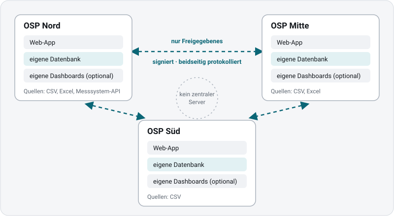
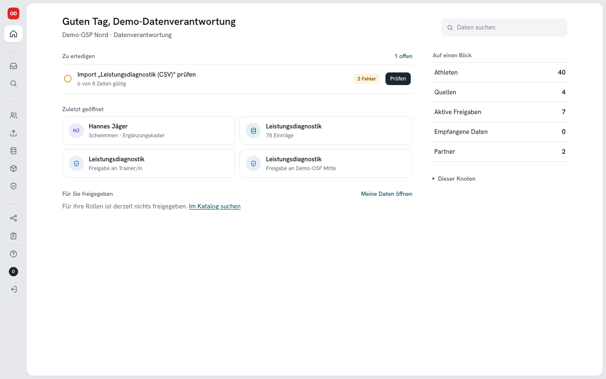
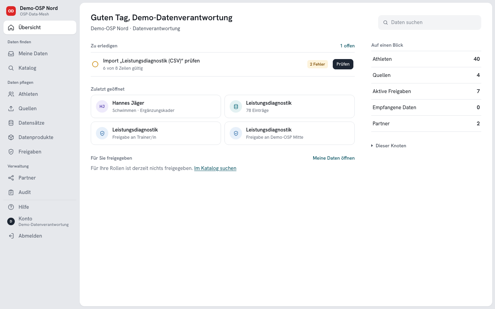
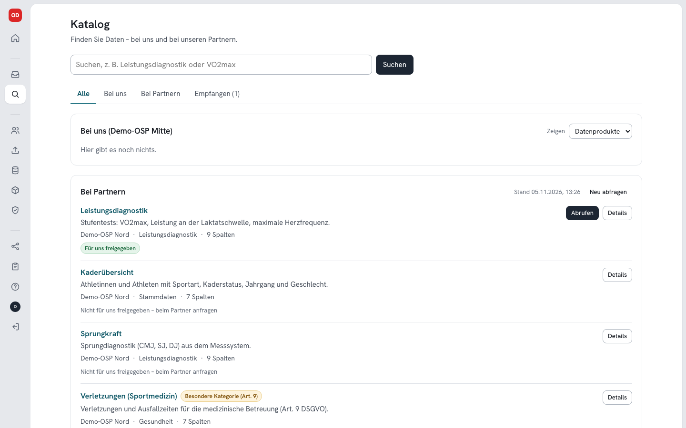
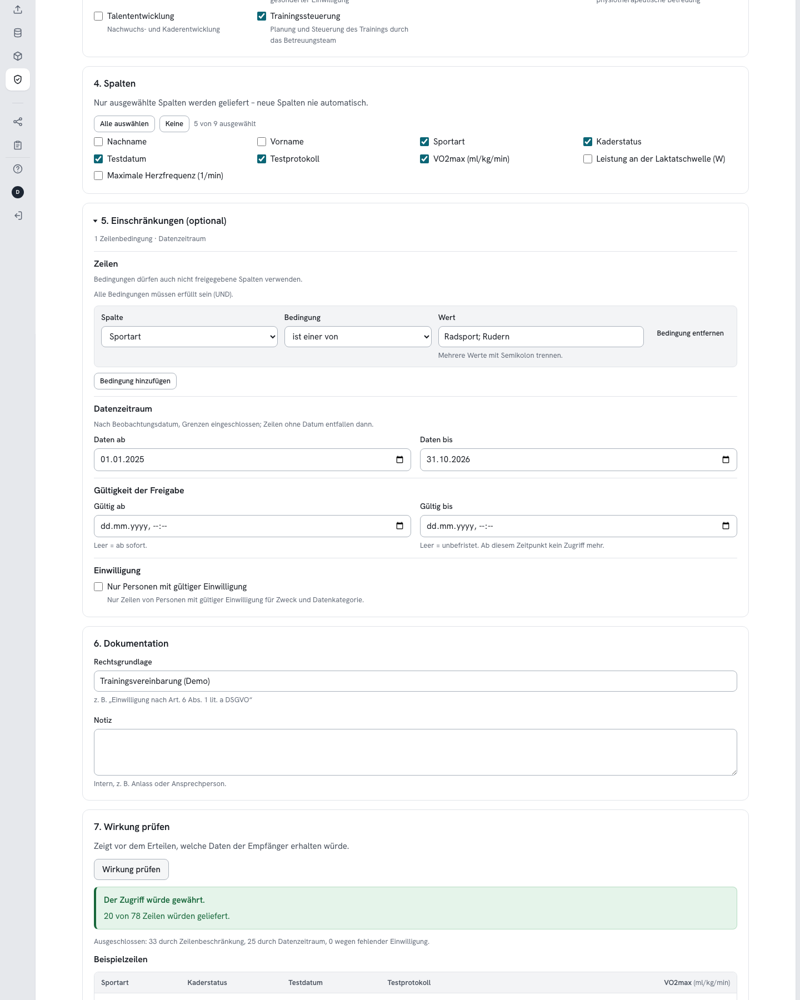
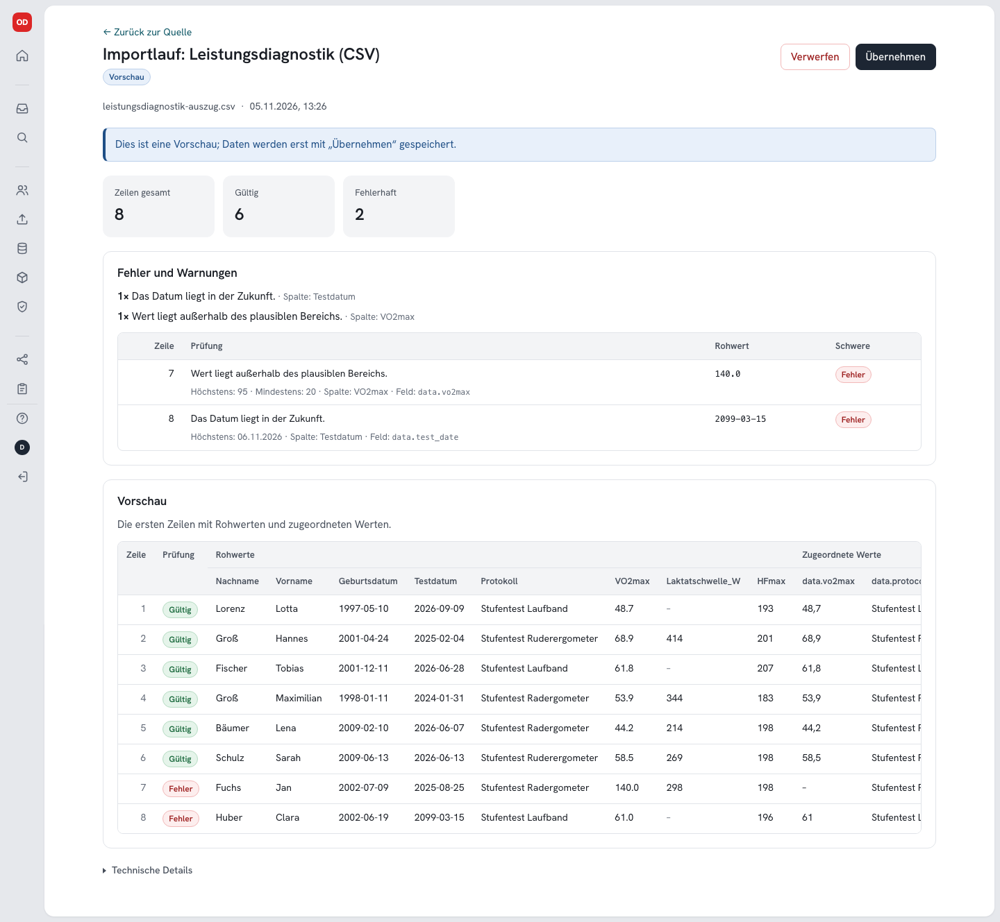
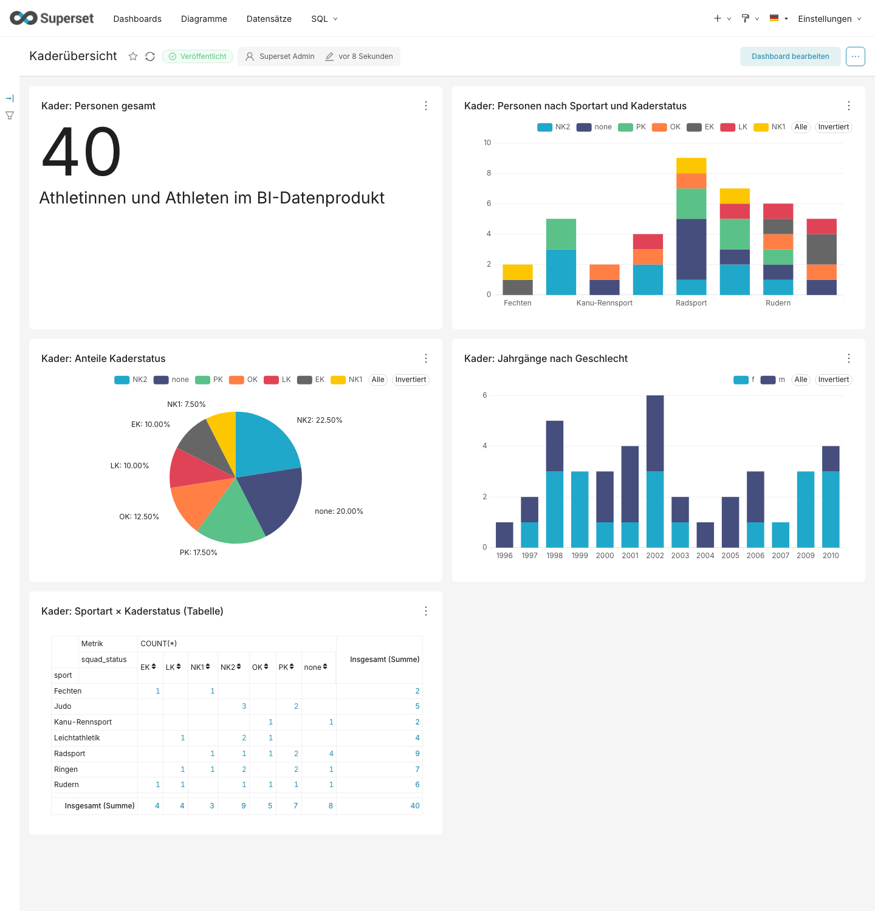

# OSP-Data-Mesh

**Ein offener Prototyp für die Ausschreibung „OSP-Data-Mesh“ des Landessportverbands Baden-Württemberg:
ein Netz von Datenknoten für Olympiastützpunkte (OSP), in dem jeder Stützpunkt seine Daten selbst behält
und nur das teilt, was er ausdrücklich freigibt.**

> Unabhängiges Open-Source-Projekt (EUPL-1.2), nicht im Auftrag des Landessportverbands. Alle Personen in
> den Beispieldaten sind erfunden. Prototyp, mit KI-Unterstützung entwickelt – vor einem Echtbetrieb sind
> Sicherheitstest, rechtliche Prüfung und ein Pilot an echten Standorten nötig.

## In einer Minute

- **Jeder OSP hat seinen eigenen Knoten** – eigene Web-Oberfläche, eigene Datenbank, optional eigene
  Dashboards. Es gibt **keinen zentralen Server** und keine zentrale Datenbank.
- **Daten kommen rein** aus CSV- und Excel-Dateien oder direkt aus Messsystemen (Schnittstellen, auch mit
  OAuth2). Jeder Import wird erst geprüft und als Vorschau gezeigt: unmögliche Werte, falsche Daten und
  fehlende Angaben fallen auf, bevor etwas gespeichert wird.
- **Nichts verlässt den Knoten ohne Freigabe.** Eine Freigabe legt fest: wer (Rolle oder Partner-OSP),
  welche Spalten und Zeilen, welcher Zeitraum, wofür (Zweck) und bis wann. Gesundheitsdaten nur mit
  dokumentierter Einwilligung.
- **Partner-OSPs** finden Angebote im Katalog und rufen freigegebene Daten direkt ab – signiert und mit
  Pseudonymen (Namen nur, wenn ausdrücklich freigegeben). Wird eine Freigabe widerrufen, löscht der Partner seine Kopie automatisch.
- **Alles wird protokolliert** – in einem Audit-Log, das sich nicht unbemerkt ändern lässt (Hash-Kette,
  zusätzlich bei Partnern verankert).
- **Auswertung** mit Apache Superset (drei fertige Dashboards) oder mit Excel, Power BI, Python & Co.
  über eine nur lesende Datenbankrolle bzw. eine REST-Schnittstelle (CSV, JSON, XML).

<p align="center">
  
</p>

| Startseite: Aufgaben, zuletzt Geöffnetes, Kennzahlen | Seitenleiste: Symbole, mit einem Klick aufgeklappt |
|---|---|
|  |  |
| **Katalog: Daten finden – bei uns und bei Partnern** | **Freigabe: genau festlegen, wer was wofür bekommt** |
|  |  |
| **Import: Vorschau mit Prüfung, bevor etwas gespeichert wird** | **Dashboard (Apache Superset)** |
|  |  |

Mehr Bilder und ein Rundgang: [docs/oberflaeche.md](docs/oberflaeche.md).

## Stand: Was umgesetzt ist

Von den 52 Anforderungen der Ausschreibung sind **38 umgesetzt und durch Tests belegt**, **13 umgesetzt**
(Dokumentation, Prozesse, Lizenz – ohne eigenen automatisierten Test) und **1 teilweise**. Alle vier
Abnahmekriterien sind im Entwicklungsumfeld erfüllt. Einzelnachweise je Anforderung:
[docs/requirements.md](docs/requirements.md).

| Bereich | Umgesetzt |
|---|---|
| Knoten | modularer Monolith je Standort, PostgreSQL, Athletenkern, dokumentiertes Datenmodell |
| Daten rein | CSV, Excel (`.xlsx`), HTTP-APIs (Token, OAuth2), wiederverwendbare Vorlagen, Vorschau, Prüfregeln, Fehlerprotokoll |
| Datenprodukte | Sichten auf Datensätze, Export als CSV/JSON/XML, REST-API mit OpenAPI |
| Freigaben | standardmäßig nichts frei; Beschränkung nach Spalten, Zeilen, Zeitraum, Zweck, Einwilligung; Widerruf |
| Austausch | direkt zwischen Knoten, signiert (Ed25519), Pseudonyme, Katalog ohne zentrale Stelle, Schlüsselwechsel |
| Datenschutz | Gesundheitsdaten als besondere Kategorie (Art. 9 DSGVO), Einwilligungen, Löschung, Widerruf bei Partnern |
| Sicherheit | Rollen und Rechte, sichere Anmeldung, verschlüsselte Geheimnisse und Sicherungen, TLS, Netztrennung |
| Audit | lückenloses Protokoll mit Hash-Kette und externer Verankerung bei Partnern |
| BI | Superset mit drei Referenz-Dashboards, offene Schnittstellen für Excel, Power BI, Python |
| Betrieb | Docker Compose mit Caddy (HTTPS), Installations- und Betriebsdoku, Sicherung/Wiederherstellung |
| Übergabe | Quellcode, Migrationen, API-Doku, Tests, Architekturentscheidungen, SBOM nach BSI TR-03183-2, deutsche HTML-Doku |

**Geprüft wurde:** 843 automatisierte Tests, 10 Abläufe im Browser, eine Demo mit drei Knoten
(57 Prüfungen), eine Neuinstallation nur nach Doku – nativ und mit Docker – und ein Prüfskript für die
Docker-Installation (TLS, Netztrennung, BI-Zugang, Superset). Dazu mehrere unabhängige Sicherheitsreviews, alle Befunde behoben.

## Was noch offen ist

- **Echte Welt:** Pilot an echten Stützpunkten; Anbindung konkreter Messsysteme bestimmter Hersteller
  (braucht deren Zugang und Schnittstellenbeschreibung).
- **Werkzeuge selbst:** Excel, Power BI, Tableau und SAP Analytics Cloud wurden nicht ausgeführt (die
  Schnittstellen dafür sind geprüft).
- **Betriebsumgebung:** Server mit Intel/AMD-Prozessor, öffentliche Domain mit automatischem Zertifikat,
  systemd-Dienst.
- **Vor dem Echtbetrieb:** externer Penetrationstest, rechtliche Prüfung des Datenschutzkonzepts,
  Zwei-Faktor-Anmeldung, Signaturschlüssel des Projekts für SBOM und Releases.
- **Nicht Teil der Software:** Schulungen, Hosting und Wartung aus der Ausschreibung.

## Ausprobieren

Voraussetzungen: [Bun](https://bun.sh) **1.4.3** und PostgreSQL 18 (Programme `initdb`, `pg_ctl`,
`psql`, `pg_dump`; anderer Ort als üblich: `MESH_PG_BIN=…`).

```sh
bun install
bun run build                       # Web-Oberfläche und deutsche Hilfe
bun run demo -- --keep-running      # drei Knoten auf http://127.0.0.1:4401, :4402, :4403
bun run demo:stop                   # alles wieder beenden
```

Anmeldung z. B. als `steward@osp-nord.example` (Datenverantwortung), `analyst@…`, `coach@…`,
`auditor@…` oder `admin@…` – Passwort `OSP-Demo-2026!`, für `osp-mitte` und `osp-sued` entsprechend.
Die Demo startet immer mit leerem Stand, importiert Beispieldaten, verbindet die drei Knoten, erteilt
Freigaben und prüft Austausch, Widerruf, Exporte, BI-Zugang, Audit und Sicherungen.

Tests: `bun test` (Unit und Integration), `bun run test:e2e` (Browser; einmalig vorher
`bun x playwright-core install chromium`), `bun run typecheck`, `bun run lint`.

Installation für den Betrieb (nativ oder mit Docker): [docs/installation.md](docs/installation.md),
danach [docs/betrieb.md](docs/betrieb.md).

## Dokumentation

Die Dokumentation ist auf Deutsch und wird vom Knoten unter `/hilfe/` angezeigt.

| Thema | Datei |
|---|---|
| Überblick | [docs/index.md](docs/index.md) |
| Oberfläche mit Bildern | [docs/oberflaeche.md](docs/oberflaeche.md) |
| Architektur | [docs/architektur.md](docs/architektur.md) |
| Freigabe- und Einwilligungsregeln | [docs/freigaberegeln.md](docs/freigaberegeln.md) |
| Austausch zwischen Knoten | [docs/protokoll.md](docs/protokoll.md) |
| Datenmodell | [docs/datenmodell.md](docs/datenmodell.md) |
| Rollen und Rechte | [docs/rollen.md](docs/rollen.md) |
| Sicherheit, SBOM | [docs/sicherheit.md](docs/sicherheit.md) |
| Datenschutz | [docs/datenschutz.md](docs/datenschutz.md) |
| Widerruf und Weitergabe | [docs/widerruf-und-weitergabe.md](docs/widerruf-und-weitergabe.md) |
| Installation, Betrieb | [docs/installation.md](docs/installation.md), [docs/betrieb.md](docs/betrieb.md) |
| REST-API | [docs/api.md](docs/api.md) |
| BI und Superset | [docs/bi.md](docs/bi.md) |
| Anforderungen und Nachweise | [docs/requirements.md](docs/requirements.md) |
| Abnahme | [docs/abnahme.md](docs/abnahme.md) |
| Architekturentscheidungen | [docs/adr/](docs/adr/) |
| Drittkomponenten und Lizenzen | [docs/lizenzen.md](docs/lizenzen.md) |

Technik: Bun · TypeScript · Hono · Kysely · PostgreSQL 18 · React · Caddy · optional Apache Superset.

## Mitmachen, Sicherheit, Lizenz

- Beiträge und Fragen: [CONTRIBUTING.md](CONTRIBUTING.md)
- Sicherheitslücken bitte vertraulich melden: [SECURITY.md](SECURITY.md)
- Lizenz: **EUPL-1.2** ([LICENSE](LICENSE)) – frei nutzbar und änderbar; veränderte Fassungen, die
  weitergegeben werden, bleiben offen. Drittkomponenten: [docs/lizenzen.md](docs/lizenzen.md); Software-
  Stückliste: [`sbom/`](sbom/).

---

## English summary

**OSP-Data-Mesh** is an open-source prototype for a public tender of the sports federation of
Baden-Württemberg (Germany): a federated network of data nodes for Olympic training centres. Each centre
runs its own node (web app + PostgreSQL) and keeps its data; data leaves a node only through explicit,
fine-grained releases (columns, rows, period, purpose, consent). Nodes exchange data peer-to-peer with
Ed25519-signed messages and pseudonyms; there is no central data store. Imports from CSV, Excel and APIs
(incl. OAuth2) are validated with a preview; all access is recorded in a hash-chained audit log anchored at
partner nodes; BI via Apache Superset or a read-only database role and REST (CSV/JSON/XML).

Status: 38 of 52 tender requirements implemented and tested, 13 implemented without a dedicated test,
1 partial; 843 automated tests, 10 browser flows, a three-node demo and a verified Docker deployment. Open:
pilot with real centres, vendor-specific connectors, penetration test, legal review. Independent project,
not commissioned by the federation; all people in the sample data are fictitious; built with AI
assistance. Quick start: `bun install && bun run build && bun run demo -- --keep-running`. Documentation is
in German (`docs/`). Licence: EUPL-1.2.
