# Oberfläche

Rundgang durch die wichtigsten Seiten der Web-Oberfläche eines Knotens. Die Bildschirmfotos stammen aus
der lokalen Demo (`bun run demo -- --keep-running`, Knoten `osp-nord` und `osp-mitte`, synthetische
Beispieldaten ohne echte Personen; Übersicht der Bilder in `docs/screenshots/README.md`). Welche
Menüpunkte jemand sieht, hängt von den Rollen ab ([Rollen und Rechte](rollen.md)); die Oberfläche blendet
nicht erlaubte Bereiche aus, der Server prüft jede Aktion zusätzlich.

Die Oberfläche ist auf Deutsch (umschaltbar auf Englisch unter *Konto*), funktioniert auf Bildschirmen ab
Smartphone-Breite und ist per Tastatur bedienbar. Die Hilfe (diese Dokumentation) ist über *Hilfe* in der
Navigation erreichbar.

Jede Seite zeigt zuerst das, was für die Aufgabe nötig ist. Technische Angaben – Kennungen, Feldpfade,
Prüfsummen, Signaturen, Versionen, Zeitstempel – stehen in aufklappbaren Bereichen (*Technische Details*,
*Herkunftsnachweis*, zugeklappte Abschnitte wie *Abrufverlauf*). Abschnitte mit Handlungsbedarf (etwa
fehlgeschlagene Mitteilungen) oder mit Eingabefehlern öffnen sich von selbst. Hinweise wie *Aktiv* oder
*Teilbar auf Anfrage* erscheinen nur, wenn sie vom Normalfall abweichen (*Inaktiv*, *Nur intern*,
*Besondere Kategorie (Art. 9)*).

## Anmelden

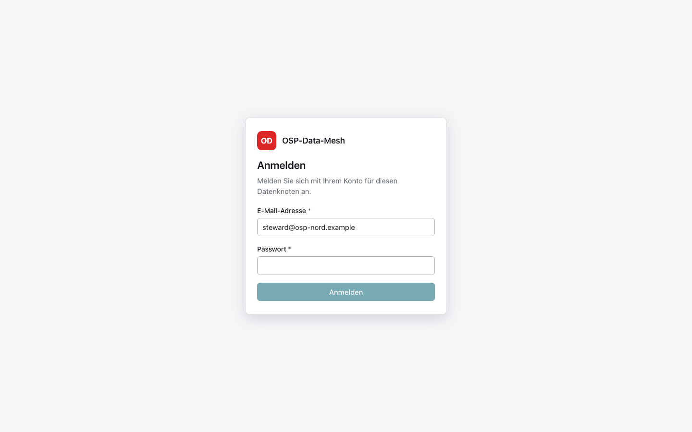

Anmeldung mit E-Mail-Adresse und Passwort. Bei falschen Angaben, einem inaktiven oder vorübergehend
gesperrten Konto erscheint immer dieselbe Meldung (nach 5 Fehlversuchen in Folge ist das Konto für
15 Minuten gesperrt; die Administration kann die Sperre unter *Benutzer* aufheben). Wer mit einem
erzeugten Initialpasswort angemeldet ist, muss zuerst ein eigenes Passwort festlegen (mindestens
12 Zeichen).

## Übersicht

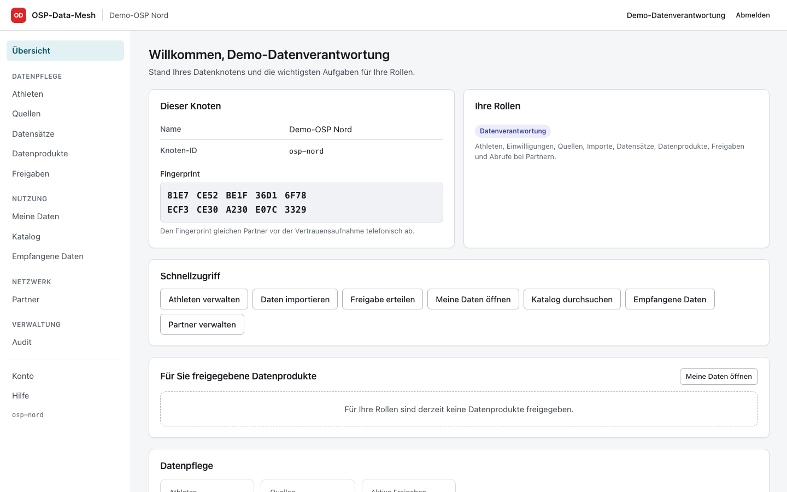

Die Startseite zeigt oben **Zu erledigen** – nur wenn es etwas zu tun gibt: ein Import, der auf Prüfung
wartet, Partner, die auf Bestätigung warten, eine fehlende, fehlgeschlagene oder zu alte Sicherung, nicht
zugestellte Mitteilungen an Partner oder Fehler der letzten 24 Stunden. Darunter stehen die für die Person
freigegebenen Datenprodukte und **Auf einen Blick** Kennzahlen je nach Rolle (Athleten, Quellen, aktive
Freigaben, empfangene Daten, Partner, letzte Sicherung, Audit-Log); jede Kachel führt zur passenden Seite.
*Dieser Knoten* (aufklappbar) zeigt Name, Knoten-ID und Fingerprint; die eigenen Rollen mit Beschreibung
stehen unter *Konto*.

Links steht die Navigation in drei Gruppen: *Daten finden* (Meine Daten, Katalog), *Daten pflegen*
(Athleten, Quellen, Datensätze, Datenprodukte, Freigaben) und *Verwaltung* (Partner, Audit, Benutzer,
System). Jede Person sieht nur die Punkte ihrer Rollen.

## Athleten und Einwilligungen

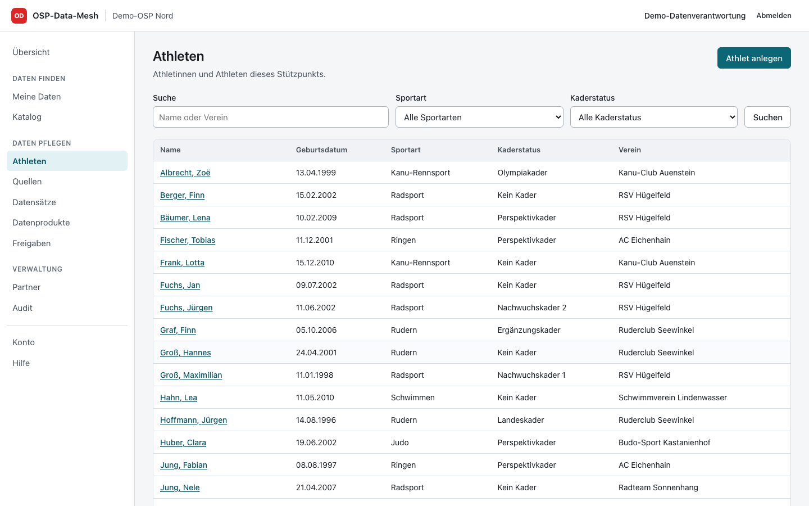

*Athleten* (Rolle `data_steward`) listet den Athletenkern mit Suche und Filtern nach Sportart und
Kaderstatus. Jeder Lesezugriff auf Personendaten wird protokolliert.

Im Personendetail stehen Stammdaten, **alle Daten der Person** je Datensatz und die **Einwilligungen**
(Zweck, Datenkategorie, Gültigkeit, Nachweis); widerrufene Einwilligungen und die Kennungen in
Quellsystemen sind aufklappbar. *Daten im Überblick* nennt je Datensatz die Zahl der Einträge und springt
zum Abschnitt mit allen Einträgen der Person (neueste zuerst), z. B. allen Leistungsdiagnostiken. Ab zwei
datierten Messungen zeigt ein **Verlauf** die Entwicklung einer Messgröße (wählbar, z. B. VO2max oder
Sprunghöhe); gibt es ein Auswahlfeld wie Testart oder Testprotokoll, vergleicht der Verlauf nur
Gleichartiges (z. B. nur CMJ-Sprünge). Jeder Abruf wird protokolliert (`dataset.read` mit Personenbezug);
Gesundheitsdaten sind als besondere Kategorie gekennzeichnet. *Widerruf erfassen* beendet eine Einwilligung sofort: Die Person
entfällt aus allen Freigaben mit Einwilligungsprüfung, BI-Tabellen werden bereinigt, und Partner, die
Daten der Person erhalten haben, bekommen eine Löschmitteilung
([Widerruf und Weitergabe](widerruf-und-weitergabe.md)). *Person endgültig löschen* setzt das Recht auf
Löschung um.

## Quellen und Importe

*Quellen* verwaltet Connectoren für CSV- und Excel-Uploads und HTTP-APIs (Messsysteme): Konfiguration,
Feldzuordnung, Zuordnung zu Personen und das Ziel (Athletenkern oder Datensatz). Die Detailseite einer
Quelle beginnt mit *Import starten*; darunter stehen ein kurzer Überblick und die Zuordnung „Quellspalte →
Zielfeld“. Feldpfade, Umwandlungen, Trennzeichen, Zeichenkodierung und ähnliche Einstellungen sind
aufklappbar, ebenso die bisherigen Läufe. Vorlagen erleichtern den Einstieg; Definitionen lassen sich als
JSON exportieren und in anderen Knoten importieren (ohne Zugangsgeheimnisse). *Beispiel abrufen* zeigt die
ersten Zeilen einer Quelle für die Zuordnung. Im Formular stehen die üblichen Angaben vorn; selten
geänderte Optionen liegen unter *Erweiterte Einstellungen* und öffnen sich, wenn sie vom Standard
abweichen oder einen Fehler enthalten.

**Excel-Dateien (.xlsx):** Als *Art der Quelle* „Excel-Upload (.xlsx)“ wählen; die Vorlage
*Leistungsdiagnostik (Excel)* ist ein Beispiel. Die zugeklappten *Excel-Einstellungen* zeigen in der
Kopfzeile, was gilt (Standard: erstes Tabellenblatt, Kopfzeile ab Zeile 1, Dezimalkomma, `DD.MM.YYYY`):
*Tabellenblatt* (Name; leer = erstes Blatt), *Kopfzeile ab Zeile* (Titelzeilen davor werden
übersprungen; fehlen in dieser Zeile zugeordnete Spalten, sucht der Import die Kopfzeile in den nächsten
10 Zeilen selbst und weist im Prüfergebnis darauf hin) sowie Dezimaltrennzeichen und Datumsformat für Werte, die als Text gespeichert sind.
Zahlen- und Datumszellen liest der Knoten unabhängig davon richtig; Formeln werden nicht berechnet,
übernommen wird das in der Datei gespeicherte Ergebnis, leere Zeilen werden übersprungen. *Datei
analysieren* nennt das gelesene Tabellenblatt; enthält die Datei mehrere, lässt sich dort ein anderes
wählen (es wird in die Einstellungen übernommen). Unter *Import starten* wird die `.xlsx`-Datei
hochgeladen; Vorschau, Prüfungen und Fehlerprotokoll sind dieselben wie bei CSV. Alte `.xls`-Dateien,
kennwortgeschützte oder beschädigte Dateien ergeben einen fehlgeschlagenen Lauf mit verständlichem Grund.

**OAuth2 bei API-Quellen:** Unter *Authentifizierung* „OAuth2 (Client Credentials)“ wählen und
*Token-Endpunkt*, *Client-Kennung* und bei Bedarf *Scope* eintragen; *Audience* und die Übermittlung der
Client-Zugangsdaten (HTTP-Basic oder im Formular) liegen unter *Weitere Abrufeinstellungen*. Das
*Client-Geheimnis* wird wie jedes Zugangsgeheimnis verschlüsselt gespeichert und nie wieder angezeigt.
Der Host des Token-Endpunkts muss wie die Adresse der Quelle für Abrufe freigegeben sein. Die Vorlage
*Sprungkraft-Messsystem (API mit OAuth2)* enthält Platzhalter-Adressen, die durch die des Herstellers zu
ersetzen sind.

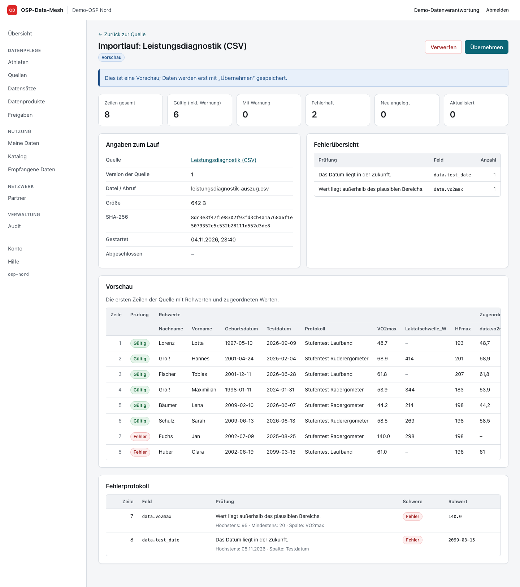

Jeder Import beginnt als **Vorschau**: Zähler (gesamt, gültig, fehlerhaft; Warnungen nur, wenn es welche
gibt), **Fehler und Warnungen** – zuerst je Prüfung und Spalte zusammengefasst, dann je Zeile mit
Grenzwerten, Feld und Rohwert – und die ersten Zeilen mit Rohwerten und zugeordneten Werten. Angaben zum
Lauf (Quellversion, Datei, Größe, SHA-256, Zeitpunkte) stehen unter *Technische Details*.
Erst *Übernehmen* speichert die Daten; *Verwerfen* löscht die Vorschau. Rohwerte gibt es nur, solange der
Lauf in der Vorschau ist; nicht übernommene Vorschauen verfallen nach 7 Tagen
([Datenmodell](datenmodell.md#datensätze-quellen-importe)).

## Datensätze und Datenprodukte

Ein **Datensatz** beschreibt die Struktur einer Datenart (Felder mit Typen, Einheiten und Prüfregeln,
fachlicher Schlüssel, Beobachtungsdatum) und ihre Einstufung (Kategorie, besondere Kategorie nach
Art. 9 DSGVO, Teilbarkeit). Eine Änderung der Einstufung wirkt auf alle darauf aufbauenden Produkte und
Freigaben ([Freigaberegeln](freigaberegeln.md#erteilen-ändern-widerrufen)).

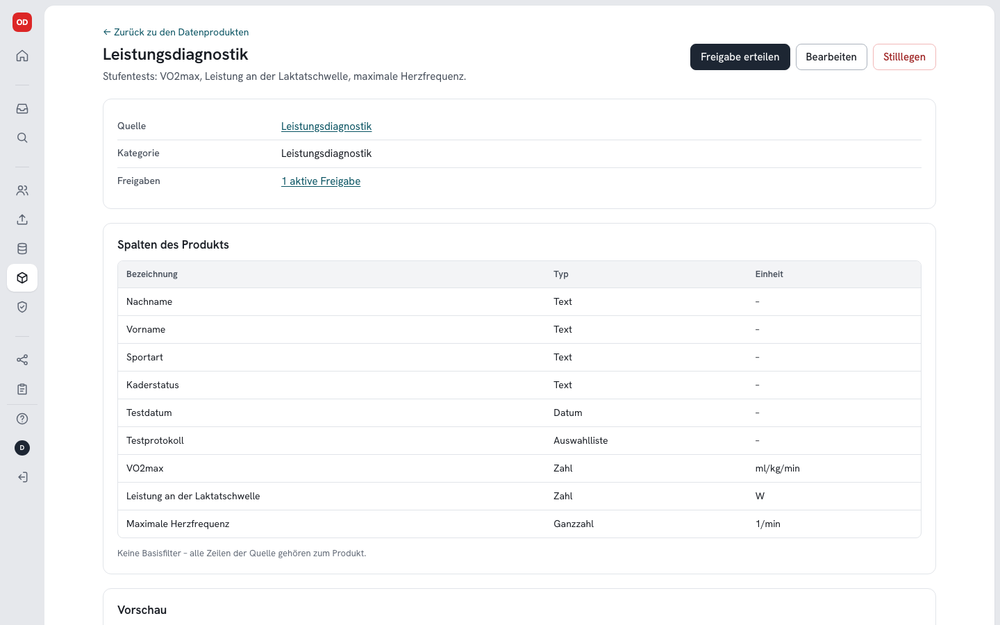

Ein **Datenprodukt** ist eine definierte Sicht auf einen Datensatz oder den Athletenkern: ausgewählte
Spalten (auch abgeleitete wie *Geburtsjahr*) und ein Basisfilter. Die Detailseite zeigt Quelle, Kategorie
und die Zahl aktiver Freigaben (als Link zur Freigabenliste), die Spalten mit Typ und Einheit
(Spaltenschlüssel und Feldpfade unter *Technische Details*) und die Vorschau, welche Zeilen das Produkt
enthält; *Freigabe erteilen* ist die Hauptaktion. Jede Änderung von Spalten oder Filtern erhöht die Version; bestehende Freigaben werden
dadurch *veraltet* und müssen neu erteilt werden.

## Freigaben

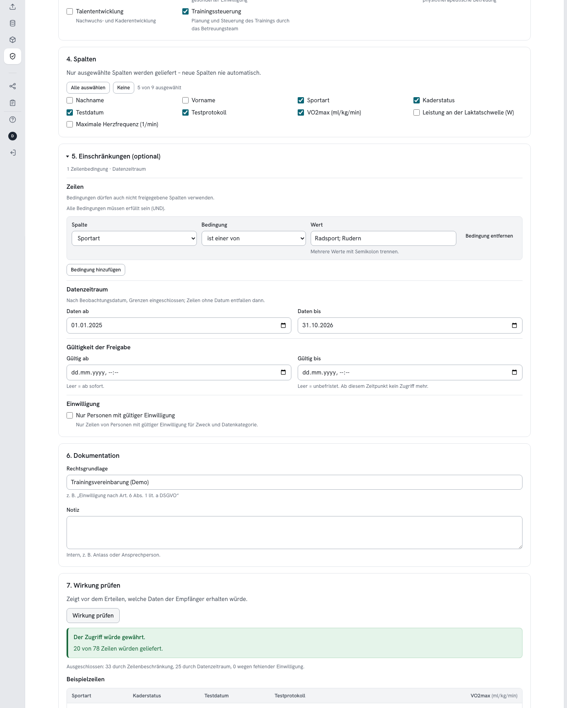

*Freigabe erteilen* führt in sieben nummerierten Schritten durch das Formular: Datenprodukt, Empfänger –
eine Rolle dieses Knotens, die BI-Schnittstelle oder ein Partnerknoten –, Zwecke, Spalten, Einschränkungen,
Dokumentation und Wirkung. Die **Einschränkungen** (Zeilenbedingungen, Datenzeitraum, Gültigkeit,
Einwilligungspflicht; bei Art.-9-Daten Pflicht) sind optional und zugeklappt; die Kopfzeile zeigt, was
gesetzt ist, und der Bereich öffnet sich bei Werten (etwa aus einer Vorlage) oder Fehlern. **Wirkung
prüfen** zeigt vor dem Erteilen, welche Daten der Empfänger für einen Zweck erhielte und wie viele Zeilen
durch Zeilenbeschränkung, Zeitraum oder fehlende Einwilligung entfallen.

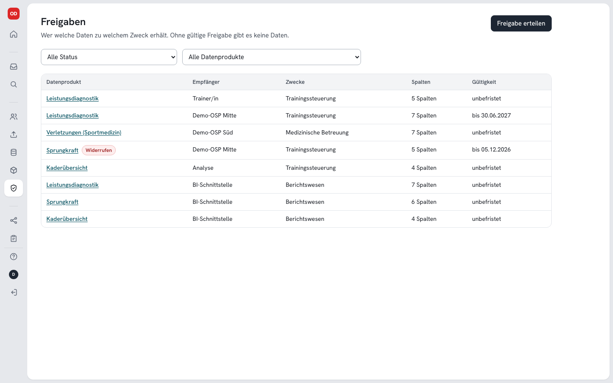

Die Liste zeigt jede Freigabe mit Empfänger, Zwecken, Spalten und Gültigkeit; der Status erscheint nur,
wenn eine Freigabe nicht aktiv ist (*geplant*, *abgelaufen*, *veraltet*, *widerrufen*). Die Detailansicht
fasst Zwecke, freigegebene Spalten, Einschränkungen und Gültigkeit zusammen; Rechtsgrundlage, Notiz und
technische Angaben sowie die Austauschhistorie sind aufklappbar. Freigaben sind unveränderlich; *Freigabe
widerrufen* (mit Begründung) wirkt sofort, Partner erhalten eine signierte Widerrufsmitteilung. Die
Rolle `auditor` sieht Freigaben nur lesend.

## Meine Daten

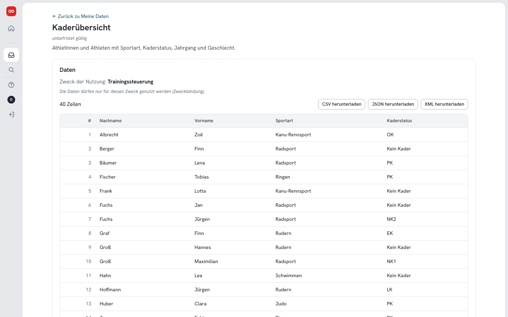

*Meine Daten* listet die Datenprodukte, die für die eigenen Rollen freigegeben sind. Nach Wahl des
**Zwecks** (Zweckbindung; gibt es nur einen, ist er vorausgewählt) werden die freigegebenen Zeilen
angezeigt und lassen sich als CSV, JSON oder XML herunterladen. Angezeigt wird nur die Zahl der
gelieferten Zeilen – nichts über Zeilen außerhalb der Freigabe. *Details zur Freigabe* zeigt Gültigkeit,
Datenzeitraum und Spalten; unter *Zugriff aus Excel, Power BI oder Python* stehen fertige Aufrufe für
curl, Python und Power BI/Excel; das nötige API-Token entsteht unter *Konto* ([REST-API](api.md)).

## Katalog: Daten finden

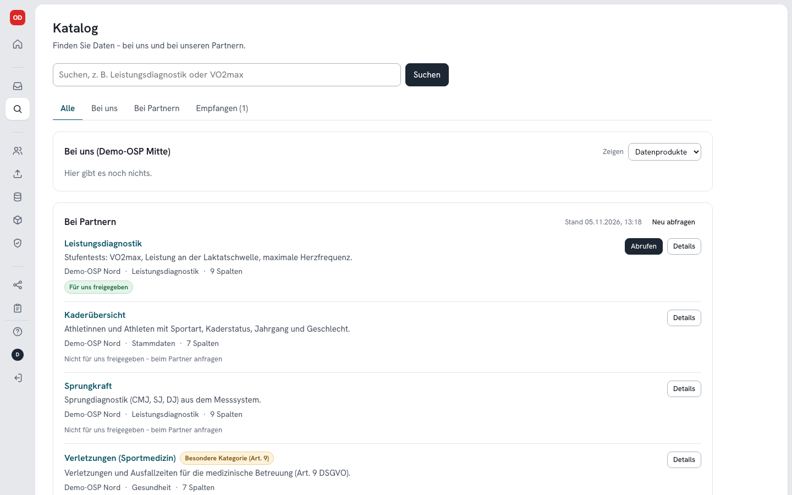

Der **Katalog** ist die eine Stelle, um Daten zu finden: ein Suchfeld und vier Bereiche.

- **Bei uns** – die Datenprodukte dieses Knotens (über *Zeigen* auch Datensätze und Quellen), nur
  Metadaten. Ist ein Produkt für die eigene Rolle freigegeben, steht dort *Für Sie freigegeben* mit
  *Daten öffnen*.
- **Bei Partnern** (Rollen `data_steward`, `analyst`) – die Angebote aller vertrauenswürdigen Partner,
  live abgefragt, ohne zentrale Stelle (das Ergebnis wird fünf Minuten wiederverwendet, *Neu abfragen*
  fragt sofort). Jedes Angebot zeigt, ob es *für uns freigegeben* ist (dann *Abrufen*, Rolle
  `data_steward`), ob schon eine Kopie da ist (*Abgerufen*, *Öffnen*) oder ob es *nicht für uns
  freigegeben* ist. *Details* zeigt Zwecke, freigegebene Spalten, Gültigkeit und Datenzeitraum der
  Freigabe; Spalten mit Typ, Kennungen und Version stehen unter *Technische Details*. Nicht erreichbare
  Partner werden oben genannt.
- **Empfangen** – alle abgerufenen Kopien mit Status, auch widerrufene und abgelaufene.
- **Alle** – alles zusammen; Kopien, deren Angebot gerade nicht erscheint, stehen unter *Weitere
  empfangene Daten*.

*Abrufen* holt die Daten signiert und pseudonymisiert ab; der Partner prüft den Zweck, der Abruf wird auf
beiden Seiten protokolliert. Die früheren Adressen `/katalog/partner` und `/empfangen` führen in die
passenden Bereiche.

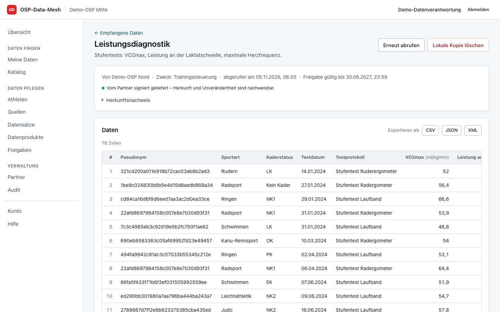

Eine empfangene Kopie zeigt in einer Zeile, von wem die Daten stammen, für welchen Zweck, wann sie
abgerufen wurden und wie lange die Freigabe gilt, dazu den Hinweis auf die Signatur des Partners. Der
vollständige **Herkunftsnachweis** (Quellknoten, Fingerprint des Datenhalters, Freigabe, Produkt und
Version, Prüfsumme und Signatur der Antwort) und der *Abrufverlauf* sind aufklappbar. Kopien werden bei
Widerruf, Ablauf der Freigabe oder Löschmitteilung automatisch gelöscht; empfangene Daten können nicht
weitergegeben werden.

## Partner

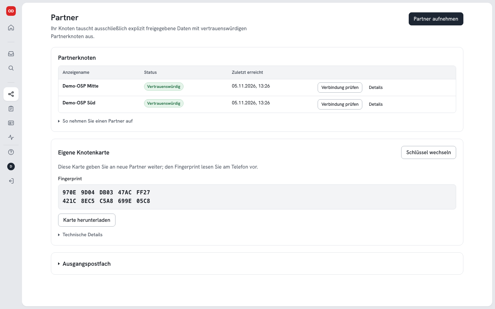

*Partner* (Rollen `admin`, `data_steward`; aufnehmen, vertrauen und sperren nur `admin`) zeigt die
Partnerknoten mit Status (*ausstehend*, *vertrauenswürdig*, *gesperrt*) und dem jeweils nächsten Schritt
(*Vertrauen bestätigen* bzw. *Verbindung prüfen*); Knoten-ID, Adresse, Fingerprint, *Bearbeiten* und
*Sperren* stehen unter *Details* in der Zeile. Darunter die Anleitung zur Partneraufnahme (aufklappbar,
ohne Partner geöffnet), die eigene **Knotenkarte** mit Fingerprint und *Karte herunterladen* (Kennungen,
öffentlicher Schlüssel und Kopierfunktionen unter *Technische Details*) und – für `admin` – das
**Ausgangspostfach** mit Widerrufs- und Löschmitteilungen (zugeklappt, öffnet sich bei ausstehenden oder
fehlgeschlagenen Mitteilungen). Die Aufnahme erfolgt in vier Schritten: Karten austauschen, *Partner
aufnehmen*, Fingerprint telefonisch abgleichen, *Vertrauen bestätigen*
([Installation](installation.md#vertrauen-mit-einem-partnerknoten-herstellen)). *Jetzt zustellen* stellt
ausstehende und fehlgeschlagene Mitteilungen sofort zu.

*Schlüssel wechseln* an der Knotenkarte (nur `admin`) fragt zuerst nach dem Anlass: **planmäßig** (Partner
werden mit einer Mitteilung benachrichtigt, die alter und neuer Schlüssel unterschreiben; Übergangszeit
wählbar) oder **Verdacht auf Kompromittierung** (keine Mitteilung; die Schritte für die telefonische
Neuaufnahme werden angezeigt). Während der Übergangszeit zeigt die Knotenkarte, wie viele Partner den
neuen Schlüssel bestätigt haben. Hat ein Partner seinen Schlüssel gewechselt, stehen in seinen Details
*Schlüssel gewechselt* und – bis zum Ende seiner Übergangszeit – der bisherige Fingerprint; *Neuen
Schlüssel eintragen* übernimmt eine neue Knotenkarte des Partners (danach erneut *Vertrauen bestätigen*)
([Betrieb](betrieb.md#knotenschlüssel-ed25519)).

## Audit, System und Benutzer

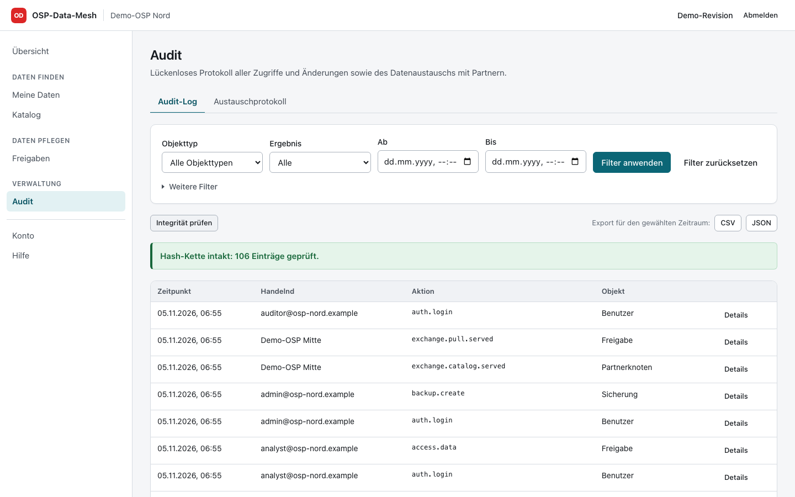

*Audit* (Rollen `auditor`, `admin`) durchsucht das Audit-Log nach Objektart, Ergebnis und Zeitraum
(Vorgang und Objekt-ID unter *Weitere Filter*), prüft die **Integrität** der Hash-Kette und exportiert den
gewählten Zeitraum als CSV oder JSON (nur `auditor`). Jede Zeile lässt sich aufklappen (Ergebnis,
Akteursart, Objekt-ID, Sequenz, IP, Request-ID, Hash, Details). Der Reiter *Austauschprotokoll* zeigt jede
Lieferung an und von Partnern; Spalten, Zeilenzahl und Prüfsumme stehen in den aufklappbaren Details.
Der Abschnitt **Externe Verankerung** (aufklappbar) zeigt den letzten bei den Partnern hinterlegten
Prüfpunkt der Audit-Kette und bietet *Mit Partnern abgleichen* (Ergebnis je Partner mit Fingerprint;
erkennt Abschneiden und Umschreiben der Kette; „Klärung nötig“ z. B. nach einer Wiederherstellung),
*Prüfpunkt jetzt senden* und *Prüfpunkt herunterladen*. Der Abgleich läuft im Server mit der Partnerliste
der Datenbank; die Oberfläche weist darauf hin, dass er deshalb nicht unabhängig von ihr ist, und verweist
auf die Prüfung mit Anker-Profil über die Kommandozeile
([Betrieb](betrieb.md#externe-verankerung-bei-den-partnern)).

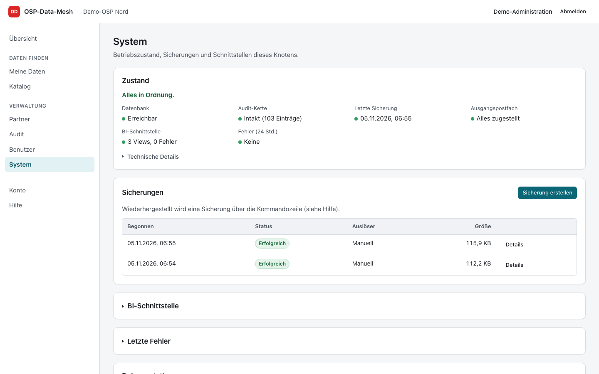

*System* (Rolle `admin`) beginnt mit dem **Zustand**: „Alles in Ordnung“ oder ein Hinweis, dazu je ein
Punkt für Datenbank, Audit-Kette, letzte Sicherung, Ausgangspostfach, BI-Schnittstelle und Fehler der
letzten 24 Stunden. Version, Laufzeit, Migrationsstand und Knotenangaben stehen unter *Technische
Details*. Darunter die Sicherungen (*Sicherung erstellen*), die BI-Schnittstelle mit Views und
Verbindungsdaten und die letzten Fehler mit Request-ID; die beiden letzten sind zugeklappt und öffnen
sich bei Fehlern ([Betrieb](betrieb.md#überwachung)).

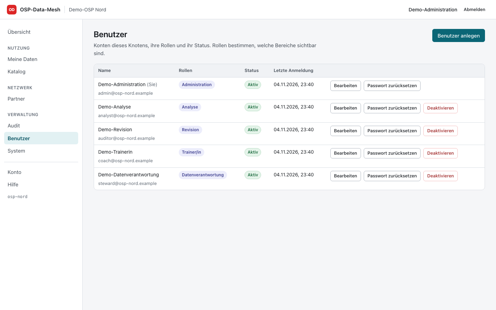

*Benutzer* (Rolle `admin`) legt Konten an, ändert Rollen, deaktiviert Konten, setzt Passwörter zurück und
hebt Sperren auf (*Passwort zurücksetzen* und *Deaktivieren* im Bearbeiten-Dialog unter *Weitere
Aktionen*); Deaktivieren und Zurücksetzen beenden die Sitzungen und widerrufen die API-Tokens der Person.
Unter *Konto* sieht jede Person ihre Rollen mit Beschreibung, ändert ihr Passwort und die Sprache und
verwaltet eigene API-Tokens.

## Mobil

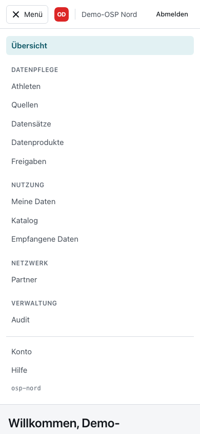
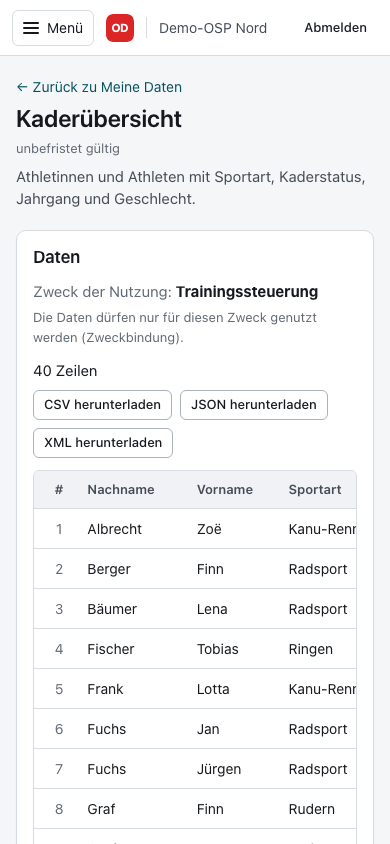

Auf schmalen Bildschirmen klappt die Navigation in ein Menü ein; Tabellen lassen sich seitlich scrollen.
So können etwa Trainerinnen und Trainer freigegebene Daten unterwegs ansehen.
